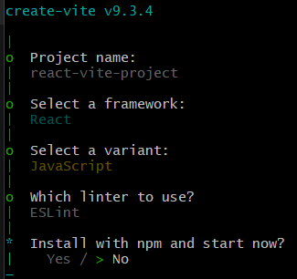
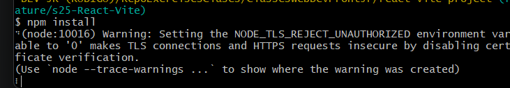
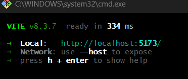

# 🛸 React

es una biblioteca de JavaScript de c��digo abierto creada por Meta (Facebook) en 2013, dise?ada espec��ficamente para construir interfaces de usuario (UI) en el desarrollo frontend
---

# 🛸 Vite


## 📋 Tabla de Contenidos
- [Creando proyecto](#-creando-proyecto)

---

## 🚀 Creando proyecto
Tener ES7+React/Redux/React-Native como plugin si se desea
```
Tener node instalado
$ node --version
v26.10.0

npm create vite@latest

```


---

—  Done. Now run:

  cd react-vite-project
  npm install
  
  npm run dev
  esto levanta un ambiente de react
  

## 📁 Plugins